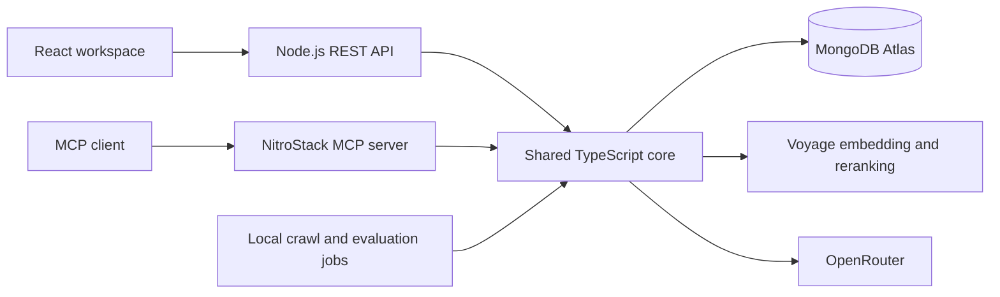

# NitroStack Knowledge Engine

A Next.js React workspace and a Node.js REST API for searching documentation, asking questions with citations, ingesting files and documentation URLs, inspecting evaluation runs, and tracking provider usage.



## Run locally

Use Node.js 24 and configure server variables from [.env.example](.env.example) in `.env.local`. The required variables are `MONGODB_URI`, `MONGODB_DB`, `VOYAGE_API_KEY`, `OPENROUTER_API_KEY`, and `LLM_MODEL`. The MongoDB database user must be able to manage search indexes for initial setup. `VOYAGE_API_BASE` defaults to the Atlas Model API. Set it to the legacy Voyage endpoint if you have a legacy Voyage key.

```sh
npm ci
npm run setup
npm run crawl -- https://docs.nitrostack.ai/docs/getting-started/overview
npm run dev
```

Open [the workspace](http://localhost:3000) and use **Connect workspace** with the key in the ignored `.env.tenant-nitrostack` file created by setup. Only key hashes are stored in Atlas. The web UI keeps the entered workspace key for its browser tab session.

Run `npm run crawl` to read the NitroStack sitemap. `CRAWL_LIMIT` limits the number of pages and `CRAWL_DELAY_MS` controls pacing. The crawler can be restarted. An identical document version is skipped. The current official documentation domain is [docs.nitrostack.ai](https://docs.nitrostack.ai/). Single page ingestion accepts that site's documentation URLs. Uploads accept Markdown, HTML, text, and PDFs with readable text, up to 3 MB. Uploads with the same filename in the same collection update the document.

## API

All endpoints use `Authorization: Bearer <workspace API key>`. The browser uses the same origin as the API.

| Method | Path | Purpose |
| --- | --- | --- |
| GET | `/api/session` | Identify the workspace and list configured answer models |
| GET | `/api/health` | Check Atlas, the search indexes, Voyage, and OpenRouter |
| POST | `/api/search` | Retrieve passages using vector or hybrid search |
| POST | `/api/answer` | Generate and validate a cited answer |
| GET | `/api/collections` | List authorized collections and their counts |
| GET | `/api/documents` | List authorized documents |
| POST | `/api/ingest` | Add or update a page or uploaded document as an admin |
| GET | `/api/documents/{id}/status` | Check whether the active version is indexed |
| DELETE | `/api/documents/{id}` | Delete a document as an admin |
| GET | `/api/sources/{id}` | Read an authorized source by document or chunk ID |
| GET | `/api/eval/runs` | Read stored evaluation runs |
| GET | `/api/usage` | Read token and cost totals by provider and model |

Search accepts `query`, `collection`, `topK`, `mode`, `rerank`, `rerankModel`, `candidates`, and `exact`. Optional `filters` accepts `sourceType` and `version`. Answers also accept a configured `model`. Hybrid uses reciprocal rank fusion over Atlas text and vector search. Both indexes filter by tenant and role. Results are checked against the current document version before they are returned. Index freshness is asynchronous and visible as `pending` until Atlas confirms both indexes can see the active version.

## Run the MCP server locally

Run `npm run mcp`. The server quietly loads `.env.local` for provider settings and reads the setup-generated NitroStack tenant key into `NITROSTACK_TENANT_API_KEY` when it is available. Existing process variables take precedence. Connect a Streamable HTTP MCP client to `http://127.0.0.1:3001/mcp`. Set `MCP_PORT` to use a different port. Send `Authorization: Bearer <workspace API key>` on every request, including initialization. The same workspace credentials and permissions apply to REST and MCP.

The server exposes `search_knowledge`, `answer_question`, `get_source`, `list_collections`, `ingest_document`, `delete_document`, and `get_usage`. `get_source` takes a `documentId` or `chunkId`. `get_usage` accepts `period` in days (7, 30, or 90). Admins can ingest a NitroStack docs `url` or an inline `file` with `name` and `base64` fields. NitroStack's HTTP JSON body limit applies to inline uploads. The REST upload route supports larger files up to 3 MB.

Run `npm run test:mcp:live` with the same local configuration and a free port. It verifies all seven tools as the configured NitroStack admin and uses a temporary second tenant with real docs pages to check isolation. It removes verification documents and temporary credentials at the end. Usage from the primary tenant's provider calls remains visible in its normal usage totals. Voyage requests are spaced at least 22 seconds apart.

### NitroStudio production mode

Open the repository in NitroStudio and select **Nitro HTTP (Production)**. Studio runs `npm run build` and then `npm run start:prod`. To reproduce the launch locally, run those same commands in that order. `npm run build:mcp` compiles just the MCP server when you only need to rebuild that service.

The production endpoint is `http://127.0.0.1:3000/mcp` by default. To use a different port, pass `npm run start:prod -- --port 3100` or set `MCP_SERVER_PORT`, `PORT`, or `MCP_PORT` in that order of precedence. If the Next.js app is already running on port 3000, select a free MCP port and use the same port in Studio. In NitroStudio's **Authentication** page, select the Task fourth project entry you are connecting and enter the existing workspace key in **Static API Key**. Streamable HTTP accepts `X-API-Key: <workspace API key>` and `Authorization: Bearer <workspace API key>` on every MCP request. If both headers are present, they must contain the same key. [NitroStudio authentication](https://docs.nitrostack.ai/docs/studio/authentication)

With the production MCP server running on its default port, run `npm run test:mcp:auth` to verify both header formats, rejected credentials, initialization, tool discovery, and a read-only `list_collections` call against Atlas.

## Verify and evaluate

```sh
npm test
npm run check
npm run build
npm run evaluate -- path/to/labeled-questions.json
```

A labeled evaluation file is a JSON array. Each row has a `query` and an `expectedUrls` array of relevant pages already indexed for that workspace. The harness measures document-level Recall@10 and nDCG@10 over the top ten passages, p50/p95 retrieval latency, and cost per query. It saves measured runs to Atlas for the Evaluation page. Set `EVAL_CONFIG` to run one configuration and `EVAL_DELAY_MS` to change the delay between queries.

Metered OpenRouter costs come from its usage response. Voyage cost estimates use its reported token usage and published list prices. Bills can differ due to included usage or geographic pricing. [Voyage pricing](https://docs.voyageai.com/docs/pricing)

## Deploy to Vercel

The standalone API is available at [nitrostack-knowledge-backend.vercel.app](https://nitrostack-knowledge-backend.vercel.app).

The frontend is available at [nitrostack-knowledge-engine.vercel.app](https://nitrostack-knowledge-engine.vercel.app).

1. From this repo root, run `npx vercel login` and `npx vercel link`.
2. Add the required server variables to the project environment in Vercel. Keep service keys and database credentials in Secret environment variables.
3. Run `npx vercel deploy` to create a preview or `npx vercel deploy --prod` to publish to the production domain.
4. Open the returned URL and check `/api/health` with a workspace key. Confirm that the selected Atlas cluster permits connections from the deployment's network.

The root project uses the Next.js preset. The standalone Node.js backend deploys from `backend/` as a separate Vercel project. Both entry points share the HTTP handler and core in `backend/core/`. Run bulk crawling and evaluation outside Vercel request handlers. [Vercel CLI deployment](https://vercel.com/docs/projects/deploy-from-cli)

To redeploy the standalone API, configure the server variables on its Vercel project and run the following from the repo root.

```sh
npx vercel deploy backend --prod --project nitrostack-knowledge-backend
```

Set `BACKEND_URL` in the frontend's `.env.local` to the backend origin. Next.js forwards local `/api/*` requests to that origin when the variable is set.

The shared core uses externally generated Voyage embeddings. NitroCloud deployment, automated Atlas embeddings, and the full PRD benchmark are outside this implementation.
